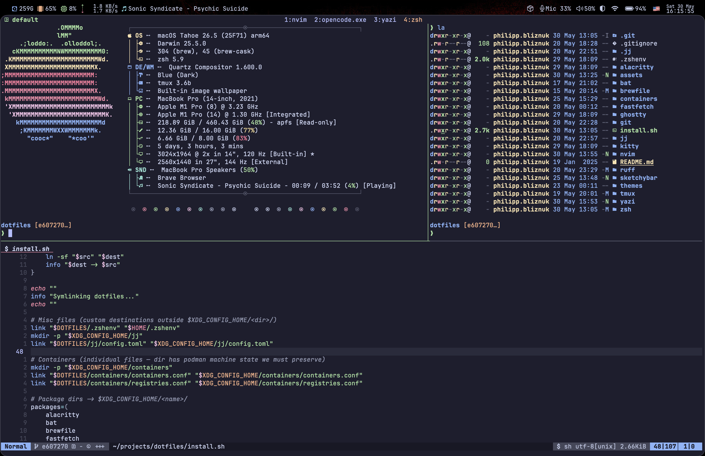
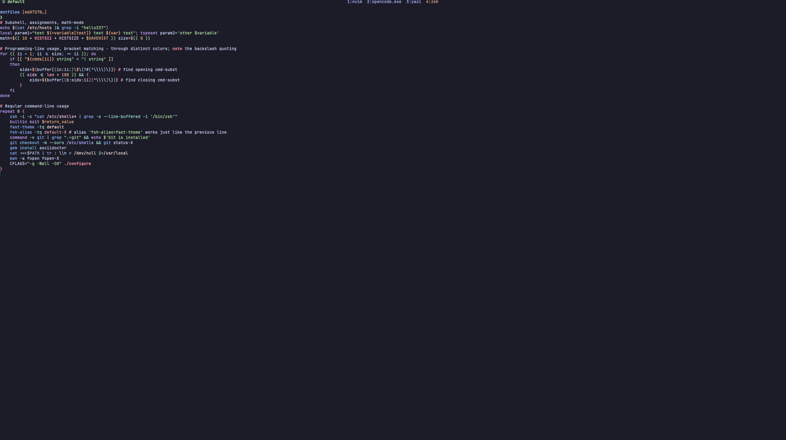
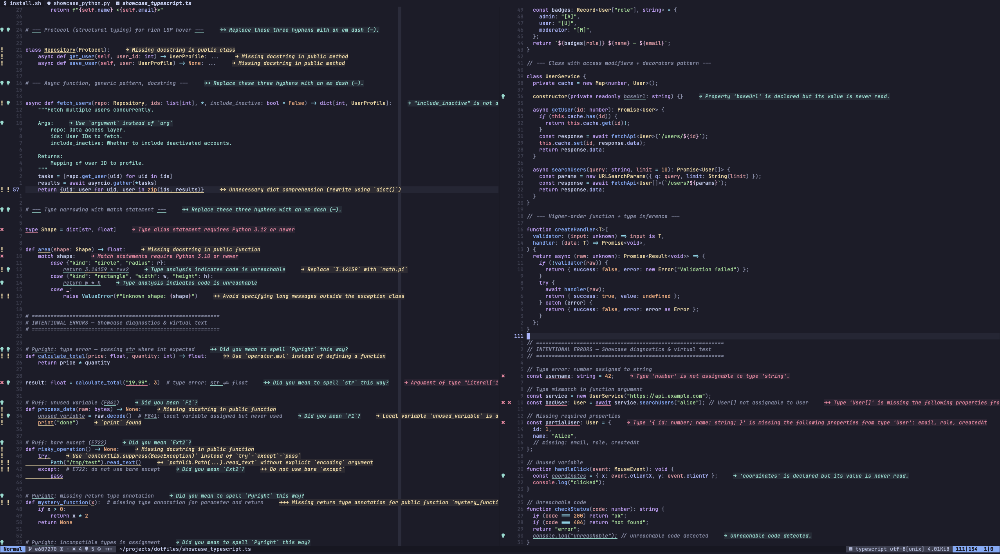
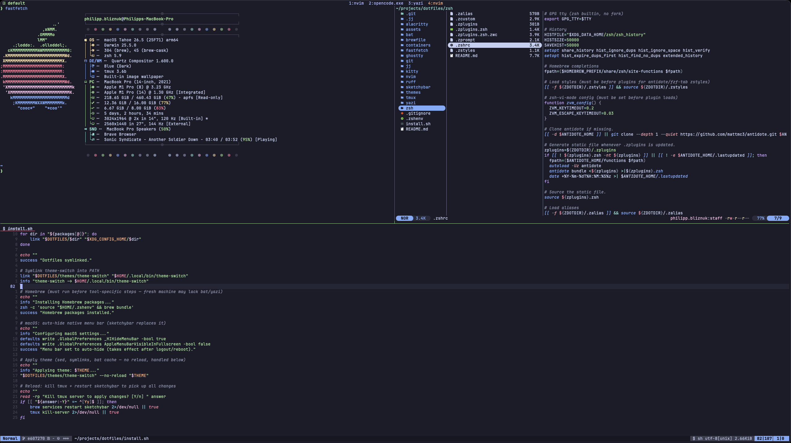

# Dotfiles



> These are my personal dotfiles. I maintain them for my own use and have no
> intention of providing support or backward compatibility. That said - you're
> welcome to fork, cherry-pick, or use any of this as inspiration for your own
> setup. If something here saves you an afternoon of research, it was worth
> publishing.

## Philosophy

This isn't a collection of configs that happen to live in the same repo. It's a
single ecosystem where every tool is aware of every other tool and they all speak
the same language.

**Core principles:**

- **One palette, everywhere** - Catppuccin Mocha, hardcoded in every config:
  terminal, shell prompt, fzf, tmux, nvim, zed, sketchybar, yazi, bat, delta,
  qutebrowser. No theme variable, no indirection.
- **XDG compliance** - only `.zshenv` lives in `$HOME`. Everything else is under
  `~/.config/`.
- **Symlink simplicity** - one idempotent `install.sh`. No stow, no Nix, no
  Ansible. Plain `ln -sf` and done.
- **Performance-first shell** - zero forks in the prompt, deferred completions,
  evalcache, compiled plugins.
- **Vi-centric** - zsh vi-mode, tmux vi keys, nvim, yazi. Same muscle memory
  everywhere.
- **Privacy & sovereignty** - Brave + LibreWolf, GPG signing via TouchID, Podman
  over Docker, `HOMEBREW_NO_ANALYTICS=1`.

## What's Inside

| Directory      | Purpose                                           |
| -------------- | ------------------------------------------------- |
| `alacritty/`   | Alacritty terminal config (fallback)              |
| `bat/`         | Syntax-highlighted `cat` replacement              |
| `bin/`         | Helper scripts linked into `~/.local/bin`         |
| `brewfile/`    | Homebrew package manifest                         |
| `containers/`  | Podman/Buildah configuration                      |
| `fastfetch/`   | System info display                               |
| `ghostty/`     | Primary terminal (custom GLSL shaders)            |
| `git/`         | Git config, global ignore, delta pager            |
| `jj/`          | Jujutsu VCS (colocated with git)                  |
| `kitty/`       | Kitty terminal config (fallback)                  |
| `nvim/`        | Neovim IDE - [full documentation](nvim/README.md) |
| `qutebrowser/` | Keyboard-driven browser                           |
| `ruff/`        | Python linter/formatter global config             |
| `sketchybar/`  | macOS menu bar replacement                        |
| `tmux/`        | Terminal multiplexer                              |
| `yazi/`        | File manager                                      |
| `zed/`         | Zed editor (secondary GUI editor)                 |
| `zsh/`         | Shell configuration                               |

## Shell



Custom zsh setup built for speed. Pure-zsh prompt (~80 lines, no starship/p10k)
that reads `.git/HEAD` directly - zero subprocess forks. Antidote plugin manager
with deferred loading, evalcache for slow evals, compiled plugins.

**Key features:** vi-mode, transient prompt, every terminal lands in one tmux
session, fast-syntax-highlighting, fzf-tab, zoxide, deferred completions for
heavy CLIs (uv, jj, podman).

## Neovim



Purpose-built IDE for Python and web development on Neovim 0.12+. Uses native
`vim.pack` (no lazy.nvim), native LSP API (no lspconfig plugin). Everything
ready at first frame.

**Highlights:** 15 LSP servers, format on save (ruff, prettierd, stylua,
goimports), blink.cmp completion, fzf-lua picker, gitsigns, treesitter
textobjects.

See [nvim/README.md](nvim/README.md) for the full breakdown.

## Tmux



Prefix `C-s`, vi copy-mode, transparent status bar. `prefix+g` opens lazygit in
a 90% popup. Sessions persist across restarts via resurrect + continuum.
Shift+Enter reaches panes as CSI-u (`extended-keys always`), so it inserts a
newline in opencode and the like.

## Zed

Secondary GUI editor for lighter sessions. Vim mode with space-leader bindings
mirroring the nvim keymap. Same LSP stack (basedpyright + ruff), same formatters
(prettierd, stylua, shfmt, goimports), same theme.

**Key features:** format on save per-language, fzf-style file finder, gitsigns
gutter, inline blame, vim surround/sneak built-in, project panel with vim keys.

## Git and jj identity

`git/config` picks `user.name`, `user.email` and `user.signingkey` per remote
(`includeIf hasconfig:remote.*.url`, one file per host alias in `git/`);
`user.useConfigOnly` refuses a guessed identity elsewhere. jj has no such
condition, so `bin/jj-identity` copies the identity git resolves into each
repo's own jj config. `jj clone` and `jj init` are aliases that run it.

## Installation

```bash
git clone https://github.com/philipp-bliznuk/dotfiles ~/projects/dotfiles
cd ~/projects/dotfiles
./install.sh
```

The script symlinks everything (configs into `~/.config/`, `bin/` into
`~/.local/bin/`), installs Homebrew packages, and optionally restarts tmux +
sketchybar. A link only ever replaces a symlink: a real file or directory in
its place (a config an app wrote first) stops the script and is named, never
deleted.

**Requirements:**

- macOS (Apple Silicon)
- Homebrew
- Neovim 0.12+
- JetBrains Mono Nerd Font (installed via Brewfile)

## License

MIT
