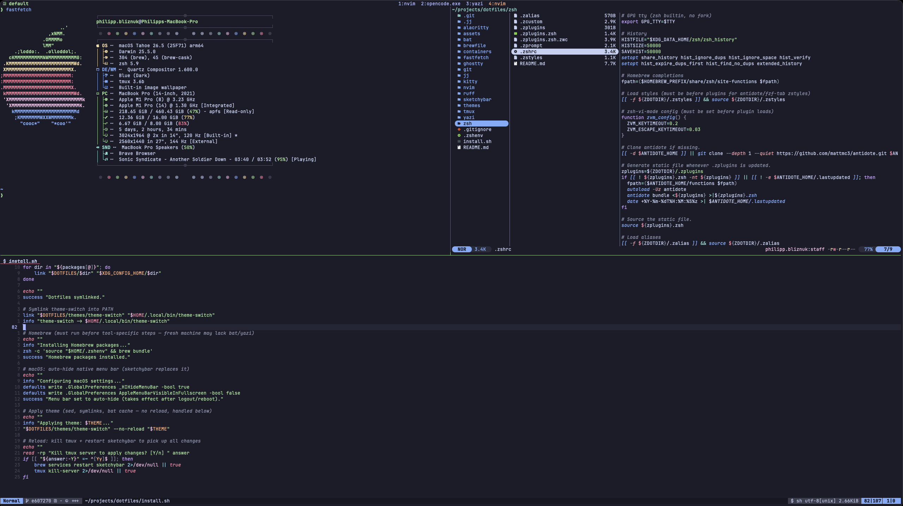
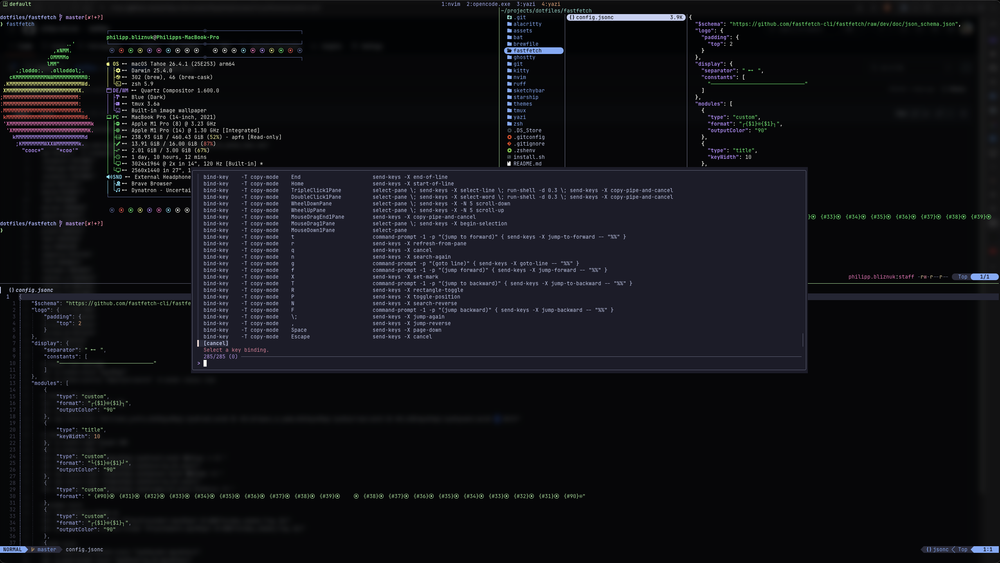

# Tmux Configuration

A minimal tmux setup with vim-style navigation, session persistence, and
Catppuccin Mocha colors written into the one config file.

## Philosophy

1. **One file, no indirection** - colors are hex literals in `tmux.conf`. No
   env vars to export, no theme files to source.
2. **Session persistence** - tmux-resurrect + tmux-continuum auto-save every
   15 minutes. Restored panes spawn fresh shells (no zombie processes).
3. **Vim everywhere** - pane navigation with hjkl, copy mode with vi bindings,
   resize with Shift+hjkl.
4. **Minimal chrome** - transparent background, centered window list, session
   indicator only. No status-right clutter.

## File Structure

```
~/.config/tmux/
  tmux.conf     Single config file (settings, binds, plugins, styles)
```

## Colors

| Color              | Used for                                       |
| ------------------ | ---------------------------------------------- |
| green `#a6e3a1`    | Active pane border, session indicator (normal) |
| red `#f38ba8`      | Session indicator (prefix pressed)             |
| yellow `#f9e2af`   | Session indicator (copy/select mode)           |
| lavender `#b4befe` | Inactive windows, messages                     |
| peach `#fab387`    | Active window                                  |
| overlay0 `#6c7086` | Inactive pane border                           |
| surface0 `#313244` | Selection background                           |
| teal `#94e2d5`     | Selection foreground                           |

## Status Bar

```
   #S                    1:zsh  2:nvim  3:yazi
```

- Left: tmux icon + session name, color changes with state
  - Green: normal
  - Red: prefix active
  - Yellow: copy/select mode
- Center: window list (index:name), zoomed indicator
- Right: empty (system bar handles monitoring)

## Keybindings

Prefix: `Ctrl+S` (`C-s C-s` sends a literal `C-s` to the pane)

### Navigation

| Key              | Action                              |
| ---------------- | ----------------------------------- |
| `h/j/k/l`        | Select pane (left/down/up/right)    |
| `H/J/K/L`        | Resize pane by 5 cells (repeatable) |
| `Tab`            | Toggle last window                  |
| `C-S-Left/Right` | Move window position                |

### Windows & Panes

| Key | Action                           |
| --- | -------------------------------- |
| `c` | New window (current dir)         |
| `"` | Horizontal split (current dir)   |
| `%` | Vertical split (current dir)     |
| `x` | Kill pane (no confirmation)      |
| `t` | Floating popup terminal (80x80%) |
| `g` | lazygit popup (90x90%)           |

### Copy Mode

| Key          | Action                                                      |
| ------------ | ----------------------------------------------------------- |
| `v`          | Begin selection                                             |
| `C-v`        | Rectangle toggle                                            |
| `y`          | Yank to tmux buffer + terminal clipboard (OSC 52, ssh-safe) |
| `Y`          | Same, plus `pbcopy` (local fallback if the terminal lacks `Ms`) |
| `Esc`        | Cancel                                                      |
| `_` / `$`    | Start/end of line                                           |
| `P` (prefix) | Paste buffer                                                |

### Utility

| Key       | Action                                |
| --------- | ------------------------------------- |
| `r`       | Reload config                         |
| `S`       | Save session (tmux-resurrect)         |
| `C-r`     | Restore session (tmux-resurrect)      |
| `Shift+F` | tmux-fzf (session/window/pane picker) |

## Plugins

| Plugin                                                           | Purpose                                  |
| ---------------------------------------------------------------- | ---------------------------------------- |
| [tpm](https://github.com/tmux-plugins/tpm)                       | Plugin manager (auto-bootstraps)         |
| [tmux-fzf](https://github.com/sainnhe/tmux-fzf)                  | Fuzzy picker for sessions/windows/panes  |
| [tmux-resurrect](https://github.com/tmux-plugins/tmux-resurrect) | Session persistence across restarts      |
| [tmux-continuum](https://github.com/tmux-plugins/tmux-continuum) | Auto-save every 15 minutes, auto-restore |

Plugins are stored in `$XDG_DATA_HOME/tmux/plugins/` (not `~/.tmux/`).
Resurrect saves the layout only: `@resurrect-capture-pane-contents` is off,
so scrollback (secrets included) is not written to disk. Its save key is moved
from `prefix C-s` to `prefix S`, otherwise it would shadow `C-s C-s`
(send-prefix), since plugins bind after the config file has run.

## Settings

| Setting              | Value           | Why                                                                                   |
| -------------------- | --------------- | ------------------------------------------------------------------------------------- |
| `default-terminal`   | `tmux-256color` | Proper terminfo (undercurl, RGB)                                                      |
| `terminal-features`  | `*:RGB`         | True color support                                                                    |
| `extended-keys`      | `always`        | Shift+Enter reaches panes as CSI-u without the pane having to ask (see `tmux.conf`)   |
| `set-clipboard`      | `external`      | Copy-mode `y` writes the terminal clipboard; a pane's own OSC 52 is ignored           |
| `escape-time`        | `0`             | No delay on Esc (vim mode)                                                            |
| `history-limit`      | `1000000`       | Generous scrollback                                                                   |
| `repeat-time`        | `1000`          | 1s window for repeatable binds (resize)                                               |
| `display-panes-time` | `2000`          | 2s pane number display                                                                |
| `allow-passthrough`  | `on`            | Image protocol for yazi                                                               |
| `base-index`         | `1`             | Windows and panes start at 1                                                          |

`set-clipboard external` means a program printing OSC 52 inside a pane (a
`cat` of a foreign file, a remote host's output) cannot replace the paste.
The flip side: a TUI on a remote host that can only reach the clipboard via
OSC 52 (nvim, lazygit, yazi over ssh) loses it; select in tmux copy mode
instead, or wrap the sequence in a DCS passthrough.
What stays open is `allow-passthrough on`: a pane can wrap OSC 52 in a DCS
that reaches the terminal as is.

## Screenshots

### Overview



### FZF Picker



## Dependencies

- `tmux` 3.2+ (for `display-popup`)
- `fzf` (for tmux-fzf)
- `git` (for TPM bootstrap)
