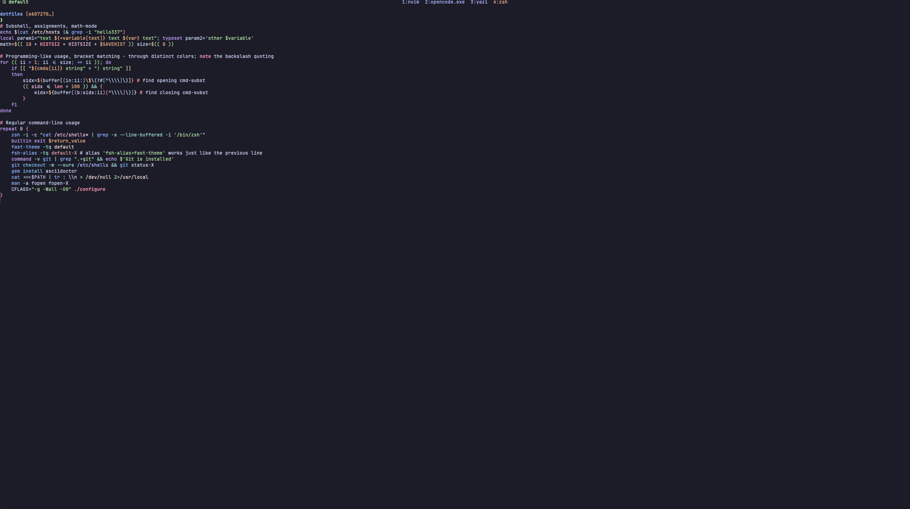
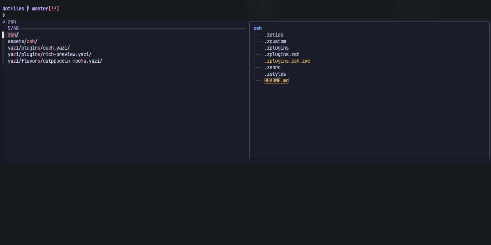
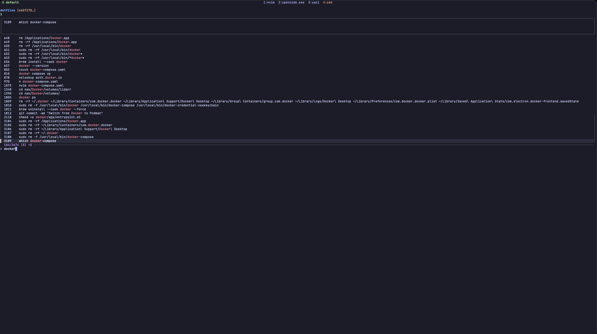
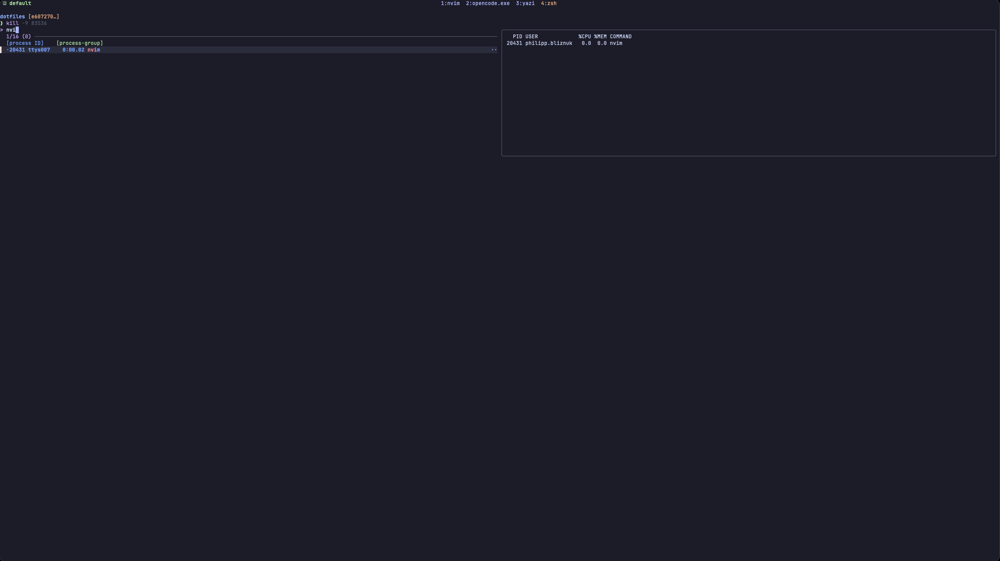
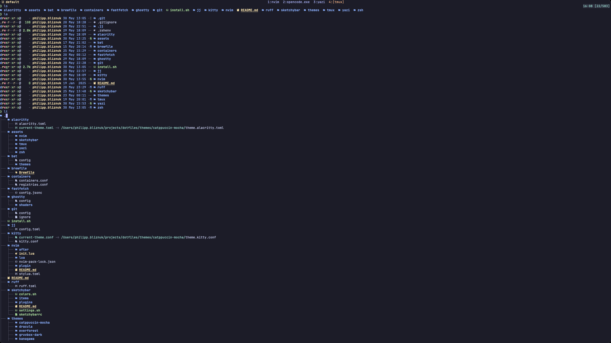

# Zsh Configuration

A performance-focused, XDG-compliant zsh setup built around the principle of
**minimal startup cost** without sacrificing functionality. Every millisecond
counts - the full init chain completes in ~60ms wall-clock time.

## Philosophy

1. **Speed first** - defer everything that isn't immediately visible. Plugins
   and completions that don't affect the first prompt load after it.
2. **XDG compliance** - nothing lives in `$HOME` except `.zshenv`. All config,
   cache, data, and state follow XDG Base Directory specification.
3. **One palette** - Catppuccin Mocha hardcoded in the prompt, fzf and
   syntax highlighting. No theme variable to resolve at startup.
4. **Static plugin loading** - plugins are bundled into a flat file when
   `.zplugins` changes, not resolved on every shell start.
5. **No redundancy** - no duplicate PATH entries, no double-sourced files, no
   overlapping plugin features.

## File Structure

```
~/.zshenv                 Environment variables, XDG, PATH
~/.config/zsh/
  .zshrc                  Main interactive config (tmux, history, plugins, evalcache)
  .zstyles                Antidote config, completion styling, fzf-tab previews
  .zplugins               Plugin declarations (antidote source-of-truth)
  .zplugins.zsh           Auto-generated static plugin file (gitignored)
  .zprompt                Pure-zsh prompt (git branch, duration, transient)
  .zalias                 Shell aliases
  .zcustom                Keybindings, FZF config, yazi wrapper
  catppuccin-mocha.ini    fast-syntax-highlighting theme
```

## Startup Flow

```
.zshenv          XDG, ZDOTDIR, Homebrew (static), PATH
    |
.zshrc           exec tmux (outside tmux, on a tty, unless NO_TMUX=1)
    |            GPG, history, fpath, zstyles, zvm_config
    |            antidote static load -> plugins sourced
    |            FZF colors, F-Sy-H theme (deferred, applied once)
    |            .zprompt
    |            evalcache: fzf, zoxide (eager)
    |            zsh-defer evalcache: uv, uvx, jj, podman (after first prompt)
    |
.zcustom         zvm hooks, FZF walker opts, yazi
```

The outer shell is replaced by tmux before anything else loads, so the init
chain runs once, inside the pane.

## Performance Strategy

| Technique                 | Savings     | Details                                                     |
| ------------------------- | ----------- | ----------------------------------------------------------- |
| Static plugin bundle      | ~50ms       | `antidote bundle` runs only when `.zplugins` changes        |
| evalcache                 | ~200ms cold | Caches `fzf --zsh`, `zoxide init` output                    |
| Deferred completions      | ~120ms cold | uv/uvx/jj/podman load after the first prompt, not before    |
| Antidote zcompile         | ~5ms        | Pre-compiles plugin scripts to wordcode (`.zwc`)            |
| Plugin deferral           | ~30ms       | fzf-tab, F-Sy-H, autosuggestions load after prompt          |
| Static brew shellenv      | ~30-50ms    | Hardcoded Homebrew paths instead of `eval $(brew shellenv)` |
| `GPG_TTY=$TTY`            | ~3-5ms      | Zsh builtin instead of `$(tty)` subprocess                  |
| `(( ${+commands[...]} ))` | ~1ms        | Hash table lookup instead of `command -v` fork              |

**Benchmark results** (Apple Silicon, warm cache):

- Wall clock: ~60ms average
- zprof total: ~30ms function time
- Largest item: evalcache sourcing (28ms, unavoidable file reads)

## Plugin Stack

| Plugin                                                                                    | Role                                  | Loading               |
| ----------------------------------------------------------------------------------------- | ------------------------------------- | --------------------- |
| [evalcache](https://github.com/mroth/evalcache)                                           | Cache slow `eval "$(cmd)"` calls      | Eager                 |
| [ez-compinit](https://github.com/mattmc3/ez-compinit)                                     | Lazy compinit (once daily)            | Eager                 |
| [zsh-completions](https://github.com/zsh-users/zsh-completions)                           | Extra completion definitions          | fpath only            |
| [fzf-tab](https://github.com/Aloxaf/fzf-tab)                                              | Replace zsh menu with fzf             | Deferred              |
| [fast-syntax-highlighting](https://github.com/zdharma-continuum/fast-syntax-highlighting) | Syntax coloring, catppuccin-mocha.ini | Deferred              |
| [zsh-autosuggestions](https://github.com/zsh-users/zsh-autosuggestions)                   | Fish-like inline suggestions          | Deferred              |
| [zsh-vi-mode](https://github.com/jeffreytse/zsh-vi-mode)                                  | Full vim keybindings                  | Eager (lazy keybinds) |

## Colors

Catppuccin Mocha, written out where it is used: `--color=` flags in
`FZF_DEFAULT_OPTS`, `%F{#hex}` in `.zprompt`, and `catppuccin-mocha.ini` for
F-Sy-H. The ini is applied once with `fast-theme` (deferred, since the plugin
loads deferred); the plugin caches the result under `~/.cache/fsh/` and skips
the step on later starts.



## Key Features

### Vim Mode with Custom Bindings

Full vi editing with `zsh-vi-mode` plus ergonomic additions:

**Insert mode** (`zvm_after_init`):

- Arrow up/down - prefix history search
- Ctrl+R - fzf fuzzy history
- Ctrl+T - fzf file picker
- Option+C (Mac `c`) - fzf cd
- Shift+Enter - accept line. Arrives as CSI-u (`^[[13;2u`) from the terminal
  keybind through tmux `extended-keys always`; unbound, zvm would read it as
  vicmd keys

**Normal mode** (`zvm_after_lazy_keybindings`):

- `H`/`L` - beginning/end of line
- `Y` - yank to end of line
- `Ctrl+h`/`Ctrl+l` - word navigation
- `Ctrl+e` - edit command in `$EDITOR`
- `U` - redo

### FZF Integration (v0.48+ built-in walker)

No `FZF_DEFAULT_COMMAND` - uses fzf's native walker with `--walker-skip` for
excluded directories. Previews powered by `bat` (files) and `eza --tree`
(directories).

- `Ctrl+T` - file/dir picker with preview
- `Option+C` - cd with tree preview
- `Ctrl+R` - history with preview + Ctrl+Y to copy
- `**<TAB>` - fd-powered completion with context-aware previews





### fzf-tab Completion Previews

Tab completion is fully replaced by fzf with contextual previews:

- `cd <TAB>` - directory tree preview
- `kill <TAB>` - process info
- `export <TAB>` - variable value
- `Ctrl+h`/`Ctrl+l` - switch completion groups



### One Tmux Session

The first lines of `.zshrc` `exec tmux new-session -A -s default` when the
shell is outside tmux on a real tty. Every terminal lands in the `default`
session; `NO_TMUX=1 zsh` opts out. Combined with `tmux-resurrect`
(`@resurrect-processes 'false'`), restored panes spawn fresh shells that go
through the full init chain.

### Yazi Shell Integration

`y` function launches yazi and `cd`s into the last active directory on exit.

### Tiered `ls` Aliases (eza)

- `ls` - compact with color + icons
- `ll` - long format with git status
- `la` - long + hidden files
- `lt` - tree view (2 levels)



### Safety Aliases

`cp -i`, `mv -i`, `rm -I`: ask before overwriting, and once before deleting
more than three files or recursing. Interactive shells only; scripts and
`command rm` are unaffected.

## Dependencies

Core tools (installed via Brewfile):

- `fzf` - fuzzy finder
- `fd` - file finder (for `**` completions)
- `eza` - modern ls replacement
- `bat` - syntax-highlighted file preview
- `zoxide` - smart cd
- `neovim` - editor
- `yazi` - terminal file manager
- `tmux` - terminal multiplexer
